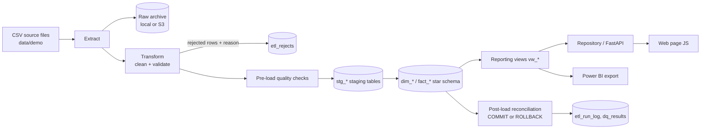

# Data engineering layer

This layer turns the original CashFlow prototype into a small data platform: raw CSV files are
extracted, cleaned, validated and loaded into a SQLite **star schema**, which the API, the web
page and Power BI read from. All data is synthetic.

## Architecture

Run it: `python -m pipeline.run_pipeline`

## Data model

| Table | Type | Grain / purpose |
|---|---|---|
| `dim_date` | dimension | one row per calendar day (year, quarter, month, weekend flag) |
| `dim_counterparty` | dimension | customers and vendors |
| `dim_category` | dimension | spend / revenue category and reporting group |
| `fact_transactions` | fact (event) | one row per cash transaction; `signed_amount` is +inflow / -outflow |
| `fact_receivables`, `fact_payables` | fact (snapshot) | open invoices |
| `fact_recurring_expenses`, `fact_payroll` | fact (snapshot) | monthly commitments |
| `fact_revenue_plan`, `fact_hiring_plan` | fact (snapshot) | planned revenue and hiring cost |
| `stg_*` | staging | raw copy of the latest extract (all text) |
| `etl_run_log`, `dq_results`, `etl_rejects`, `ref_settings` | operational | audit trail and settings |

Reporting views (`warehouse/views.sql`): `vw_monthly_cashflow`, `vw_category_monthly`,
`vw_vendor_spend`, `vw_receivables_aging`, `vw_payables_due`, `vw_runway`.

## Design decisions

- **Idempotent, incremental loads.** `fact_transactions` is append-only. Each row gets a hash of its content
  plus its occurrence number, so re-running the same file inserts nothing new, new rows are appended, and
  legitimately identical rows are both kept.
- **Snapshot tables are reloaded** inside the same transaction, because their source is a "current state" list.
- **All-or-nothing load.** The load runs in one transaction. If reconciliation fails (row counts, amount totals,
  foreign keys), the transaction is rolled back and the warehouse is unchanged. The failure is still logged.
- **No silent fixes.** Invalid rows (bad date, bad number, negative amount, unknown type) are rejected with a
  reason and stored in `etl_rejects`. A missing column stops the run.
- **Raw zone.** Every run archives the exact source files under its run id (`LocalArchive`, or `S3Archive`
  when `CASHFLOW_S3_BUCKET` is set).
- **SQL and Python agree.** `vw_runway` re-implements the cash / burn / runway maths in SQL, and a test checks
  it equals `core/calculations.py`.

## Data-quality checks

Pre-load: source not empty (HIGH), rows rejected (MEDIUM), repeated transaction rows (LOW),
due date not before invoice date (MEDIUM).
Post-load: staging row reconciliation (HIGH), inflow and outflow amount reconciliation (HIGH),
foreign-key integrity (HIGH). A failed HIGH check blocks or rolls back the load.

## Layering (MVC-style)

- **Model:** `warehouse/schema.sql`, `warehouse/views.sql`, `warehouse/repository.py`
- **Controller:** `api.py` (FastAPI routes)
- **View:** `web/index.html` (JavaScript, calls the API) and the JSON responses

## SQL practice

`warehouse/analytics_queries.sql` holds 11 named queries (window functions, LAG, RANK, moving average, CTEs,
self-join, pivot with CASE, correlated subquery). List them with `python -m warehouse.queries`.

## Cloud (optional)

`S3Archive` uploads the raw files to an S3 bucket using standard AWS credentials (environment or IAM role).
It is unit-tested with a fake client only; it has **not** been run against a real AWS account. Install with
`pip install -r requirements-cloud.txt` and set `CASHFLOW_S3_BUCKET`.

## Limitations

SQLite and a handful of small CSV files, run on demand. There is no scheduler, no streaming, no big-data
engine and no real source system. In production this would move to a managed warehouse, an orchestrator
(for example Airflow) and incremental extraction from the source systems.
